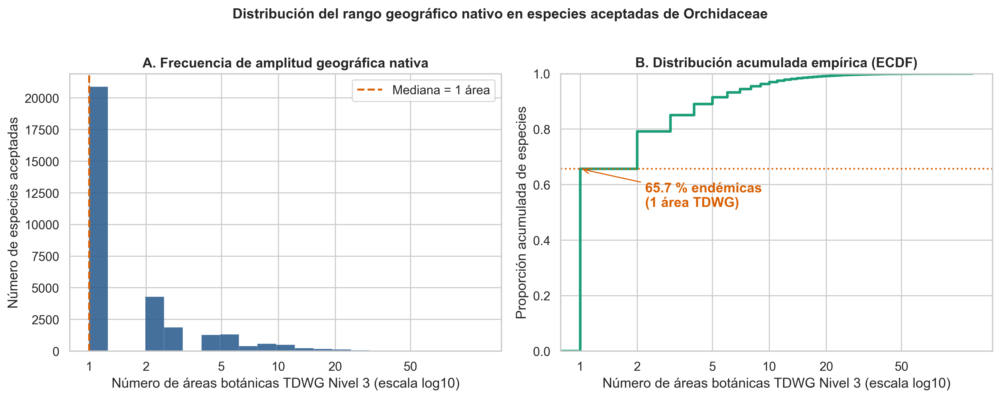
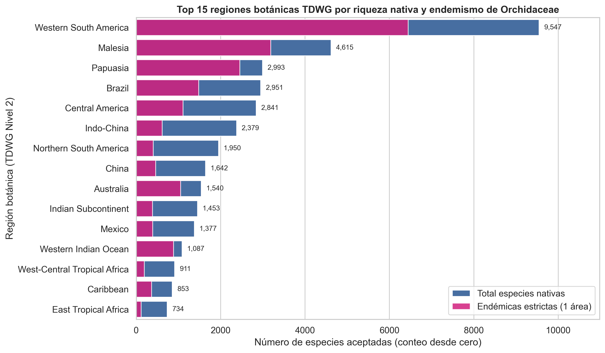
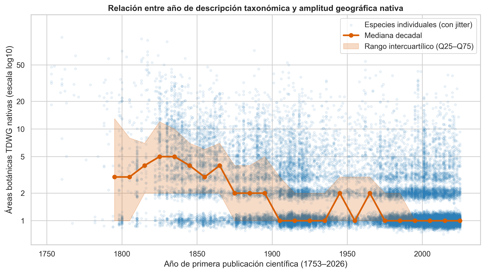
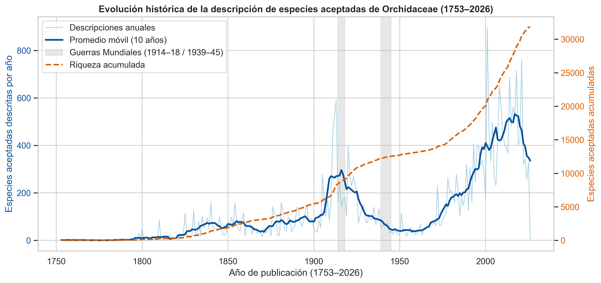
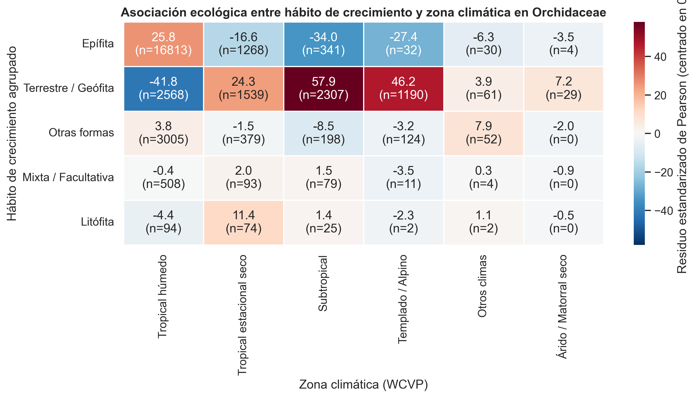
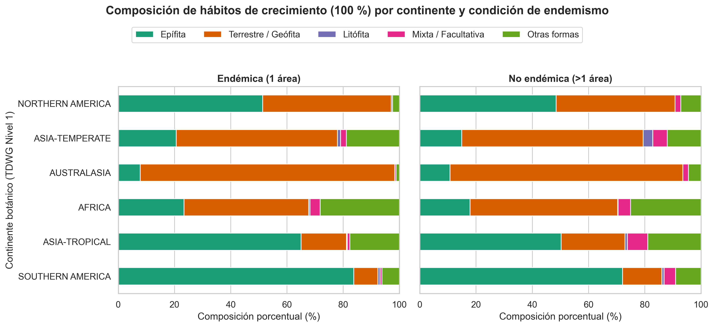

# Análisis Exploratorio de Datos: Familia *Orchidaceae* (WCVP)

## Conjunto de datos y procedencia
Este análisis explora la familia **Orchidaceae** a partir del **World Checklist of Vascular Plants (WCVP)** (*Royal Botanic Gardens, Kew*), contenido en `Orquideas.zip` (`wcvp_names.csv`, `wcvp_distribution.csv` y `README_WCVP.xlsx`). Se examinaron variables taxonómicas, ecológicas y de distribución geográfica nativa en unidades botánicas TDWG.

## Preguntas de investigación
1. ¿Qué proporción de especies aceptadas de *Orchidaceae* presenta distribución restringida a una sola área botánica y en qué regiones se concentra la mayor riqueza nativa?
2. ¿Cómo se asocia el hábito de crecimiento con la zona climática y cómo cambia esa composición entre especies endémicas y no endémicas?
3. ¿Cómo ha evolucionado históricamente la descripción de especies aceptadas y qué relación tiene la fecha de publicación con la amplitud geográfica nativa?

## Figuras principales y lectura

El 65,7 % de las especies aceptadas habita en una sola área TDWG (mediana = 1), mostrando una fuerte asimetría hacia la derecha.

*Western South America* encabeza la riqueza nativa (9.547 especies) seguida de *Malesia* (4.615), con alta presencia de endemismos estrictos.

Las especies descritas en épocas más recientes tienden a presentar rangos geográficos medianos más estrechos que las descritas en los siglos XVIII y XIX.

La riqueza acumulada supera las 30.000 especies con caídas visibles durante las guerras mundiales y un marcado repunte reciente.

Las especies epífitas destacan en climas tropicales húmedos, mientras que las terrestres/geófitas sobresalen en zonas subtropicales y templadas/alpinas.

La proporción de hábitos varía claramente entre continentes tropicales y templados tanto en especies endémicas como no endémicas.

## Reproducibilidad
1. Instala dependencias: `pip install -r requirements.txt`
2. Coloca `Orquideas.zip` en la carpeta raíz del proyecto.
3. Ejecuta `python eda_orquideas_wcvp.py` (o abre y ejecuta el cuaderno) para regenerar las figuras en `figuras_eda/`.